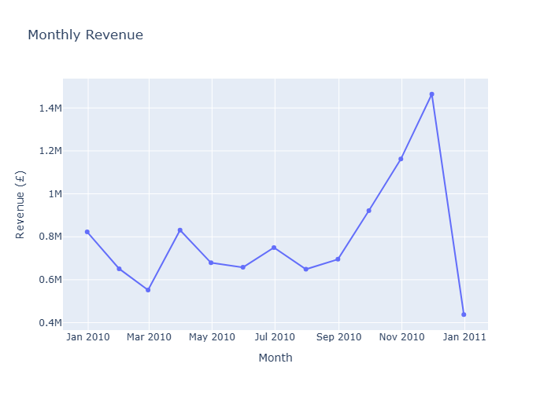
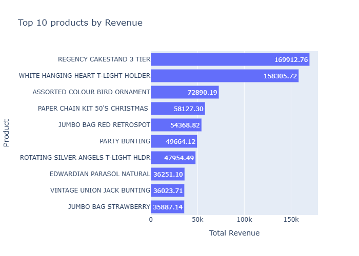
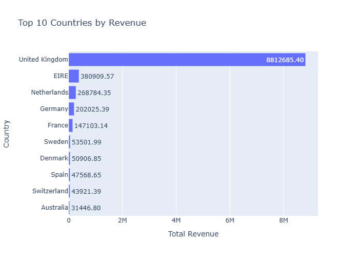
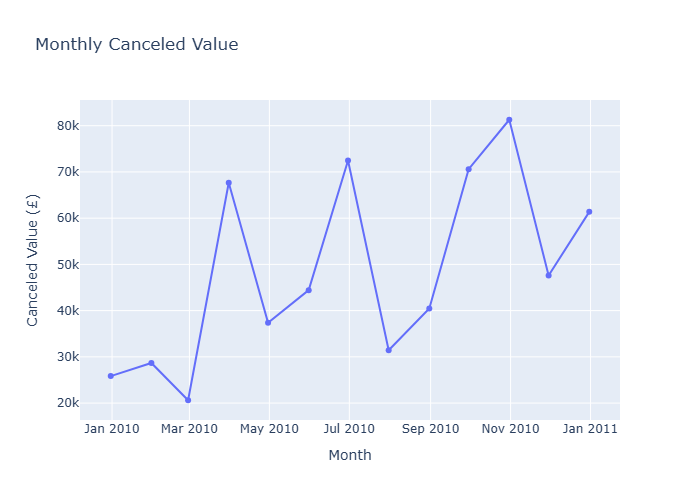

# Online Retail Sales Analysis

## Project Overview

This project analyzes transactional data from an online retail store to understand its sales performance during the available period. The analysis focuses on sales trends over time, product performance, geographic distribution of sales, and the financial impact of canceled transactions.

The project uses Python and Pandas for data preparation and analysis, and Plotly for interactive data visualization.

## Business Problem

An online retail store has a large volume of transactional data covering more than one year of sales. However, raw transaction data alone does not provide a clear overview of the store's sales performance.

A systematic analysis is needed to identify sales trends over time, determine which products and countries contribute most to revenue, and assess the overall performance of the store during the available period. Understanding these patterns can help identify the strongest and weakest areas of the business and provide useful insights for decision-making.

## Objective

Analyze the behavior of the online store's sales during the available period, identifying the products and periods with the greatest and lowest performance, and quantifying the generated revenue.

## Dataset

The dataset contains transactional records from an online retail store, including information about invoices, products, quantities, prices, dates, customers, and countries.

The original dataset was obtained from Kaggle:

**Online Retail Dataset** — Lakshmi Narasimhan
[Kaggle dataset](https://www.kaggle.com/datasets/lakshmi25npathi/online-retail-dataset/data?utm_source=chatgpt.com)

The original `.xlsx` file is not included in this repository. An unmodified local copy was retained as the source dataset, while the cleaned version used for the analysis is included in the `data/` directory.

The main variables used in the analysis are:

* **Invoice:** Invoice identification number.
* **StockCode:** Product identification code.
* **Description:** Product description.
* **Quantity:** Number of units in the transaction.
* **InvoiceDate:** Date and time of the transaction.
* **Price:** Unit price of the product.
* **Customer ID:** Customer identification number.
* **Country:** Country associated with the transaction.

The dataset covers transactions from **December 1, 2009 to December 9, 2010**, across **40 countries**.

The analysis considers transactions with `Quantity > 0` and `Price > 0` as effective sales. Cancellation transactions are analyzed separately.


## Methodology

### 1. Data Cleaning

- Exact duplicate records were identified and removed.
- Negative-quantity transactions were investigated to distinguish cancellation records from inventory adjustments.
- Inventory adjustment records were excluded from the analysis.
- Negative-price records identified as bad-debt adjustments were excluded.
- Zero-price transactions were retained in the dataset but excluded from effective sales and revenue calculations.
- Missing values were assessed and retained when they did not affect the metrics used in the analysis.
- Transaction dates were converted to datetime format for time-based analysis.

### 2. Sales Definition

Effective sales were defined as transactions satisfying:

- `Quantity > 0`
- `Price > 0`

Revenue was calculated as:

`Revenue = Quantity × Price`

Cancellation transactions were identified as invoices whose `Invoice` value starts with `C` and were analyzed separately from effective sales.

For product-level analysis, `POST`, `DOT`, and `M` transaction codes were excluded because they represent postage or manual charges rather than physical products.

### 3. Analysis

The analysis was structured around four business questions:

- How did sales evolve over time?
- Which products had the best and worst performance?
- Which countries accounted for the majority of sales?
- What was the impact of canceled sales?

The main metrics included monthly revenue, units sold, effective invoices, revenue and units sold by product, revenue and units sold by country, revenue per unit, and canceled value.

### 4. Visualization

Plotly was used to create interactive visualizations for the main findings, including:

- Monthly revenue
- Top 10 products by revenue
- Top 10 countries by revenue
- Monthly canceled value

## Key Findings

### Sales Performance

Monthly revenue decreased from December 2009 to February 2010, reaching its lowest value among complete months at **£551,878**. After fluctuating during the middle of the year, revenue increased substantially from September to November 2010, reaching its highest value among complete months at **£1,464,293**.

The number of units sold and effective invoices followed a similar pattern, with both reaching their highest values in November 2010 at **725,161 units** and **2,747 invoices**, respectively.

December 2010 is incomplete, as the dataset only contains transactions through December 9.



### Product Performance

The **REGENCY CAKESTAND 3 TIER** generated the highest revenue among the analyzed products, with **£169,912.76** in total revenue.

The **WHITE HANGING HEART T-LIGHT HOLDER** generated the second-highest revenue at **£158,305.72** and was also the product with the highest number of units sold, with **58,386 units**.



### Geographic Performance

The **United Kingdom** generated approximately **£8.81 million** in revenue and **4.70 million units sold**, making it the largest market in the dataset by both metrics.

The ranking of countries differed depending on the metric used. For example, **Denmark** ranked second in units sold with **229,690 units**, while **Germany** ranked fourth in units sold but generated substantially higher revenue than Denmark.



### Cancellation Impact

The dataset contains **4,591 unique cancellation invoices**, involving **213,289 canceled units** with a total canceled value of approximately **£629,809**.

The total canceled value represents approximately **6.13% of effective sales revenue** during the available period.

**September 2010** recorded the highest number of canceled units, while **October 2010** recorded the highest canceled value, at approximately **£81,291**.



## Business Insights

- The monthly revenue and units sold showed a similar pattern throughout the year, with a decrease at the beginning, fluctuations during the middle of the year, and a substantial increase toward the end. This indicates that sales performance was considerably stronger during the final months of the observed period. This pattern may be related to seasonal demand toward the end of the year, although the dataset does not provide enough information to establish a specific cause.

- The product analysis shows that product performance cannot be explained by a single metric. Some products ranked among the top 10 by revenue but not by units sold, and vice versa. This indicates that both revenue and sales volume should be considered when evaluating product performance.

- The geographical analysis shows that the United Kingdom is the main market in the dataset, accounting for the majority of revenue and units sold. International sales provide a different perspective, as some countries with high sales volumes did not generate the highest revenue. This indicates that both sales volume and revenue should be considered when evaluating geographic performance.

- The cancellation analysis shows that the month with the highest number of canceled units did not necessarily have the highest canceled value. This indicates that the number of canceled units alone does not determine the financial impact of cancellations, as the value of the canceled products also plays an important role.

## Conclusions

The overall analysis showed that revenue and sales volume should not be analyzed separately, as both metrics provide complementary perspectives on the performance of the online retail business. Revenue and sales volume followed similar patterns over time, but higher sales volume did not necessarily result in higher revenue.

Geographically, the United Kingdom accounted for the highest revenue and sales volume in the dataset. Internationally, higher sales volume did not necessarily correspond to higher revenue, as differences in revenue per unit contributed to the performance of different countries.

Similarly, the number of canceled units alone did not determine the financial impact of cancellations, as the value of the canceled products also played an important role.


## Tools and Technologies

- **Python** — Data cleaning, transformation, and analysis
- **Pandas** — Data manipulation and aggregation
- **NumPy** — Numerical operations
- **Plotly** — Interactive data visualization
- **Jupyter Notebook** — Analysis and documentation
- **Git & GitHub** — Version control and project repository

## Project Structure

```text
Online retail project/
├── data/
│   ├── online_retail.xlsx
│   └── online_retail_clean.csv
├── images/
│   ├── monthly_revenue.png
│   ├── product_revenue.png
│   ├── country_revenue.png
│   └── cancellations.png
├── notebooks/
│   ├── 01_exploration.ipynb
│   └── 02_analysis.ipynb
├── README.md
├── requirements.txt
└── .gitignore